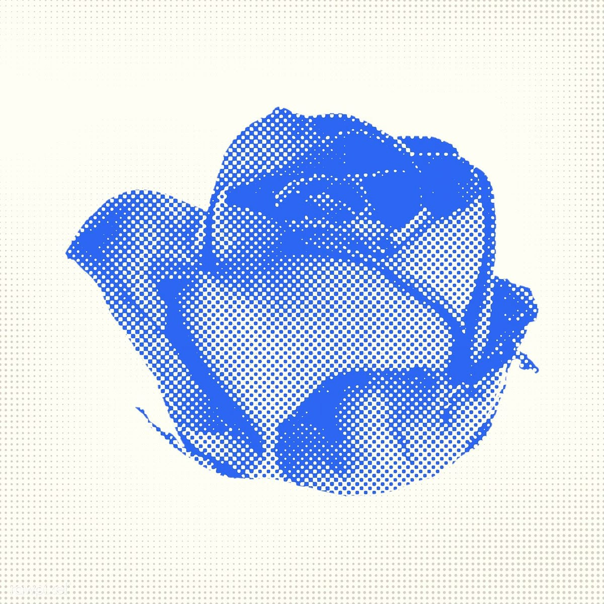
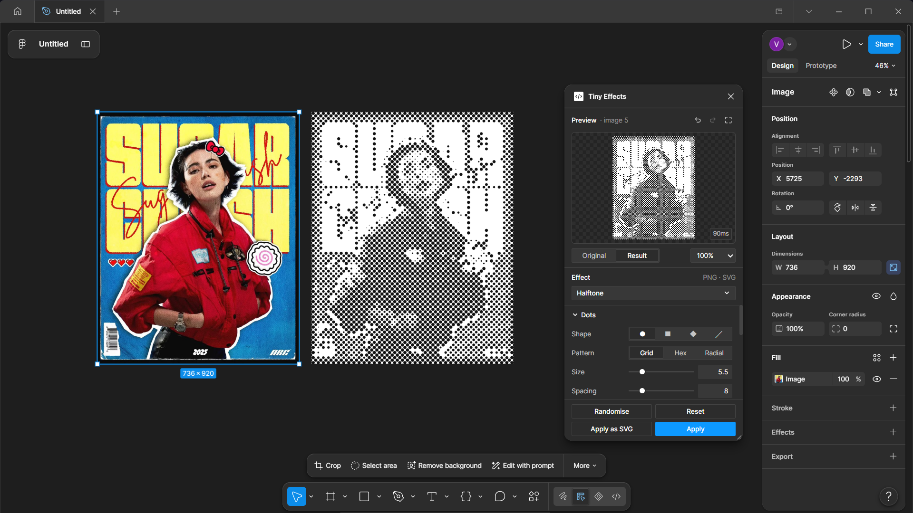
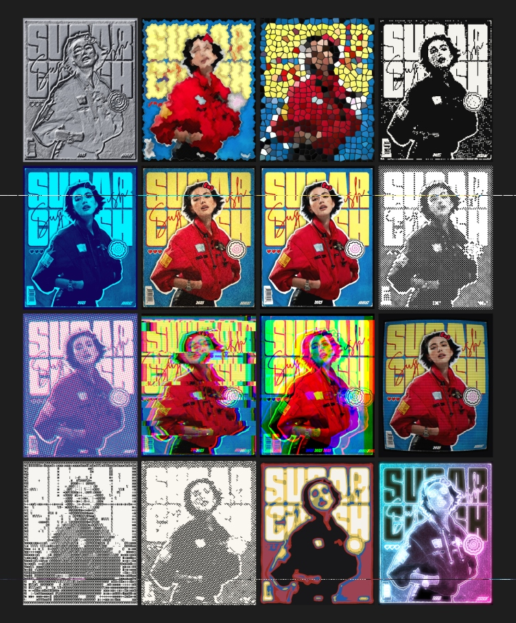

#  Tiny Effects

**Local-only raster & editable vector image effects for Figma.**  
Select an image. Pick an effect. Tweak it. Drop it back on the canvas as a new layer.



---

## Overview

**Tiny Effects** is a native-feeling Figma plugin that transforms any image layer into stylised raster (`PNG`) or editable vector (`SVG`) artwork across **20 local effect engines** — including **Halftone**, **ASCII**, **Dithering**, **Pixelate**, **Glitch**, **Risograph**, **Stippling**, **Crosshatch**, **Photocopy**, **Pixel Sorting**, **RGB Split**, **CRT Scanlines**, **Cutout**, **Neon Glow**, **Film Grain**, **Engraving**, **Mosaic**, **Watercolor**, **Emboss**, and **Duotone**.

Everything runs **100% locally** inside the plugin (`"networkAccess": { "allowedDomains": ["none"] }`). There is no backend, no account, no cloud processing, and no AI API.

### Key Highlights

- **Native Figma UI3 Design**: Built exclusively with Figma's semantic CSS tokens (`--figma-color-*`) for seamless Light and Dark theme support, `11px` Inter typography, scrubbable parameter labels, collapsible sections, and zero visual clutter.
- **One Engine, Two Outputs**: Interactive previews and full-resolution exports share the exact same deterministic rendering algorithms.
- **Editable Vector Output (`Apply as SVG`)**: Generates real, grouped Figma vector nodes (`<circle>`, `<rect>`, `<polygon>`, `<line>`, `<path>`, `<text>`) rather than flattened bitmaps wherever supported.
- **Non-Destructive Workflow**: Never modifies or overwrites your source layer. Outputs are placed cleanly beside the original layer on the canvas.
- **Instant Two-Pass Preview**: Slider adjustments render an immediate low-latency interactive pass followed by a high-definition preview pass once idle.

---

## Effects Library



| Effect | Description | PNG | Editable SVG |
| :--- | :--- | :---: | :---: |
| **Halftone** | Circle, Square, Diamond, and Line screens; Grid, Hex staggered, and Radial patterns; Monochrome, RGB, Source, and **4-channel CMYK separation** (`15°`, `75°`, `0°`, `45°`). | Yes | Yes (shapes grouped by channel) |
| **ASCII** | Standard, Blocks (`█▓▒░`), Binary, Minimal, Dense, and Custom character sets; Mono, Source colour, and 2-Tone modes. | Yes | Yes (live `<text>` nodes) |
| **Dithering** | **Atkinson**, **Floyd–Steinberg** (with serpentine scan), and **Bayer** (`2×2`, `4×4`, `8×8`) matrices; 1-Bit custom and curated retro palettes (*Game Boy, Newsprint, CGA, 8-Colour, 16-Colour*). | Yes | Yes (run-length `<rect>` nodes) |
| **Pixelate** | Linked or independent cell dimensions, Average / Center / Dominant colour sampling, cell gap, corner radius, and palette quantization. | Yes | Yes (`<rect>` grid) |
| **Glitch** | Per-channel RGB split (`X`/`Y`), seeded horizontal slice displacement, block corruption, CRT scanlines, and static noise. | Yes | — |
| **Risograph** | 1 to 4 ink drums with curated Risograph ink presets, per-drum registration misalignment & skew, grain, halftone screen dots, and multiply overprint blending. | Yes | — |
| **Stippling** | Brightness-weighted stratified dot placement with adjustable density, min/max dot size, scatter jitter, and deterministic seed. | Yes | Yes (`<circle>` nodes) |
| **Crosshatch** | Up to 4 multi-angle tonal hatching passes driven by luminance thresholds with adjustable line weight, spacing, and hand-drawn jitter. | Yes | Yes (`<path>` strokes by pass) |
| **Photocopy** | High-contrast xerox toner transfer with edge halo accentuation, toner dust/grit, and vertical drum streaks. | Yes | — |
| **Pixel Sorting** | Horizontal or vertical interval span sorting driven by luminance, saturation, or red channel thresholds with span jitter. | Yes | — |
| **RGB Split** | Linear angle, radial lens chromatic aberration, or manual X/Y channel separation. | Yes | — |
| **CRT Scanlines** | Cathode-ray tube simulation with aperture grille/slot phosphor masks, barrel curvature, halation bloom, and scanline depth. | Yes | — |
| **Cutout** | Matisse / Bauhaus paper-cut posterization with spatial shape simplification, paper depth shadows, and curated palettes. | Yes | Yes (layered `<rect>` shapes) |
| **Neon Glow** | Sobel edge detection with multi-radius neon tube bloom, white-hot cores, and single, gradient, or source colour modes. | Yes | — |
| **Film Grain** | Midtone-weighted 35mm emulsion grain with Kodak/Fuji/Ilford film stocks, matte fade, vignette, and film scratches. | Yes | — |
| **Engraving** | Copperplate / banknote guilloché line engraving with wave amplitude/frequency modulation and variable stroke weight. | Yes | Yes (variable-width `<polygon>` lines) |
| **Mosaic** | Stained-glass Voronoi cells, Hexagonal honeycomb, and Running-bond brick tiles with adjustable bevel and grout lines. | Yes | Yes (`<polygon>` / `<rect>` tiles) |
| **Watercolor** | Kuwahara brush wash simplification, domain-warped wet pigment bleed, darkened edge pooling, and cold-press paper texture. | Yes | — |
| **Emboss** | 3D directional surface-normal bump mapping with azimuth/elevation lighting and Stone, Metallic Foil, or Colour relief modes. | Yes | — |
| **Duotone** | Split-tone and 3-stop tritone gradient mapping with curated colour presets, midpoint gamma shift, and mix control. | Yes | — |

---

## Controls & Keyboard Shortcuts

### Scrubbable Inputs
- **Drag any property label** horizontally to scrub its value.
- Hold **`Shift`** while scrubbing or pressing arrow keys for **`×10`** steps.
- Hold **`Alt`** while scrubbing or pressing arrow keys for **`×0.1`** fine steps.
- **Double-click any slider** to reset that parameter to its default value.
- Click the **reset icon (`⟲`)** on any section header to reset that section.

### Shortcuts

| Shortcut | Action |
| :--- | :--- |
| `Enter` | **Apply** (creates a new high-res raster layer next to the source) |
| `Shift + Enter` | **Apply as SVG** (creates editable vector layers next to the source) |
| `\` *(hold backslash)* | Hold to **Compare** with the original source image |
| `R` | **Randomise** parameters for the current effect |
| `Ctrl/Cmd + Z` | **Undo** parameter or effect change |
| `Shift + Ctrl/Cmd + Z` | **Redo** parameter or effect change |
| `Double-click preview` | Reset preview pan & zoom to `100%` |

---

## Installation & Usage (Figma Desktop)

1. Clone or download this repository and install dependencies:
   ```bash
   npm install
   ```
2. Build the plugin bundle (`dist/controller.js` and single-file `dist/ui.html`):
   ```bash
   npm run build
   ```
3. Open the **Figma Desktop** app and open any design file.
4. Go to **Plugins → Development → Import plugin from manifest…** and select [`manifest.json`](./manifest.json).
5. Select any layer on your canvas that has an **Image fill** and run **Plugins → Development → Tiny Effects**.

---

## Project Architecture

```text
tiny-effects/
├─ manifest.json               # Figma plugin manifest (local-only, networkAccess: none)
├─ image.jpg                   # Plugin artwork / icon
├─ screenshot.png              # Plugin preview screenshot
├─ effects-showcase.jpg        # 16-effect showcase grid
├─ ui.html                     # Vite entry template
├─ vite.config.ts              # Single-file UI bundler configuration
└─ src/
   ├─ controller/              # Figma Sandbox Controller (no DOM/Canvas)
   │  ├─ main.ts               # Plugin lifecycle, UI sizing (300×560), message routing
   │  ├─ selection.ts          # Selection inspection & topmost visible image fill extraction
   │  └─ output.ts             # Non-destructive raster & SVG node creation on canvas
   ├─ engine/                  # Pure TypeScript Effects Engine
   │  ├─ effects/              # Independent modules: halftone, ascii, dither, pixelate,
   │  │                        # glitch, risograph, stippling, crosshatch
   │  ├─ color.ts              # Luma, tone curve, CMYK separation & retro palettes
   │  ├─ prng.ts               # Deterministic Mulberry32 seeded PRNG
   │  ├─ svg.ts                # Clean vector SVG document & geometry builders
   │  ├─ worker.ts             # Inline Web Worker for off-thread rasterization
   │  └─ pipeline.ts           # Two-pass resolution scaling & stale-render dropping
   ├─ shared/                  # Strict TypeScript contracts
   │  ├─ messages.ts           # Discriminated union message protocol
   │  └─ types.ts              # Parameter schema & EffectDefinition interfaces
   └─ ui/                      # Figma-Native React UI
      ├─ App.tsx               # State management, history stack, keyboard shortcuts
      ├─ components/           # Section, ScrubInput, SliderField, Segmented, ColorField...
      ├─ panels/               # PreviewPanel, EffectPicker, PropertiesPanel, Footer
      └─ styles/               # Figma UI3 CSS variables (tokens.css & base.css)
```

---

## Scripts

| Command | Description |
| :--- | :--- |
| `npm run build` | Runs TypeScript typecheck (`tsc --noEmit`), bundles `dist/ui.html` (via Vite + `vite-plugin-singlefile`), and bundles `dist/controller.js` (via `esbuild`). |
| `npm run typecheck` | Verifies strict TypeScript types across controller, engine, and UI. |
| `npm run check` | Runs full typecheck and production build verification. |
